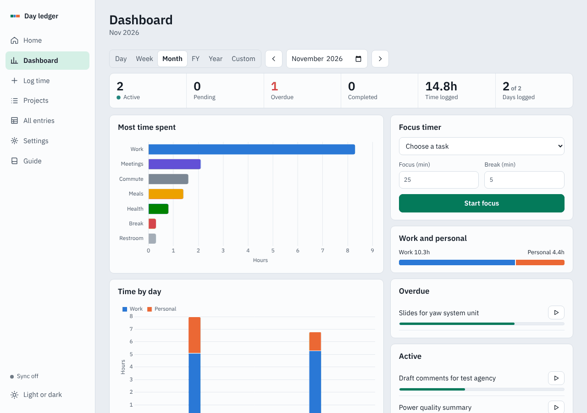

# Day ledger

A personal time and project tracker that runs in the browser. Log everything you do, work and personal, from a one-line entry, and see it by day, week, month and financial year.

**Live app:** https://sathyanarayanan-2001.github.io/day-ledger/



## Features

- **Quick log:** type `10:15 restroom 5m` or `yesterday 9-11:30 grid code review`.
- **Fill in any time:** a 24-hour strip shows unlogged gaps, for any past day, week, month or year.
- **Breaks handled for you:** a break inside a task comes off that task's time. Only real clashes raise a prompt.
- **Projects, tasks and sub-tasks:** with automatic project IDs, keyword matching and progress bars.
- **Dashboard:** task status, time spent, planned vs actual, logging streak and a focus timer.
- **All entries:** filter, sort and group, export to CSV, Excel or PDF, and import CSV or Excel.
- **Works everywhere:** phone and laptop layouts, dark and light modes, and offline use.
- **Reporting periods:** ISO calendar weeks and April to March financial years.

## Your data

Entries are stored in your browser, not in this repository and not on any server. To share them between devices, you choose a folder and the app writes its save files there. A OneDrive folder lets OneDrive carry those files, as described in the [setup guide](docs/SETUP.md).

The app makes no network requests for your data, and the page has no accounts, analytics or trackers.

## Getting started

Open the [live app](https://sathyanarayanan-2001.github.io/day-ledger/) in Chrome or Edge. The first visit opens a guide, and [docs/SETUP.md](docs/SETUP.md) covers syncing laptops and an Android phone.

Folder sync needs the File System Access API, which Firefox and Safari don't support. Other features work in those browsers, and you can move data with backup files.

## Development

Requires Node 20 or later.

```bash
npm ci
npx playwright install chromium   # first time only
npm start                         # http://localhost:8123
npm test                          # build, then run the browser tests
```

```text
src/            App source: core.js (logic), sync.js (storage), app.js (UI)
scripts/        Build script and local server
tests/          End-to-end browser tests
public/         Icons copied into the build
docs/           Setup guide and architecture notes
dist/           Build output (generated, not committed)
```

`npm run build` puts the libraries, font, styles and code into one `dist/index.html`, so the app has no CDN dependencies. See [docs/ARCHITECTURE.md](docs/ARCHITECTURE.md).

Each push to `main` runs the tests and deploys to GitHub Pages.

## Contributing

This is a personal project, but issues and suggestions are welcome. See [CONTRIBUTING.md](CONTRIBUTING.md) and the [changelog](CHANGELOG.md).

## License

[MIT](LICENSE). Bundled libraries keep their own licenses, listed in [THIRD_PARTY_NOTICES.md](THIRD_PARTY_NOTICES.md).
